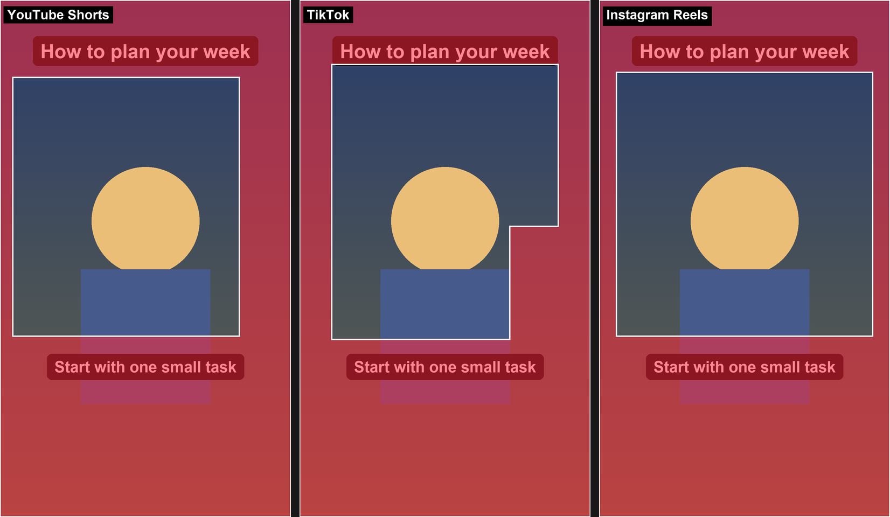

# shorts-safezone

See what YouTube Shorts, TikTok and Instagram Reels cover on a 9:16 video: the like and comment buttons, the channel name, the caption. The zones are measured from each platform's own templates, and every number says where it came from.



*A made-up frame. The title at the top and the caption near the bottom are both covered on every platform. TikTok's zone has a step where its buttons sit on the right.*

## Install

```
pip install shorts-safezone
```

Reading a video frame needs [ffmpeg](https://ffmpeg.org) on your PATH. Images work without it.

## Check a video or an image

```
shorts-safezone check my_short.mp4 --at 3.5
```

Writes `my_short.safezone.png`: the frame at 3.5 s, once per platform, with the covered area in red.

```
shorts-safezone check thumbnail.png --platform youtube,tiktok -o check.png
```

## Check a box

Is a caption at x 150, y 1250, 780 x 90 px safe on a 1080 x 1920 video?

```
$ shorts-safezone box 150 1250 780 90
YouTube Shorts   covered at the bottom edge
TikTok           covered at the bottom edge
Instagram Reels  covered at the bottom edge
```

It exits with 1 when the box is covered anywhere, so it can guard a render script. Add `--json` for machine-readable output and `--size 720x1280` for other 9:16 sizes.

From Python:

```python
from shorts_safezone import Box, check_box

check_box(Box.from_xywh(150, 1250, 780, 90))
# {'youtube': ['bottom'], 'tiktok': ['bottom'], 'reels': ['bottom']}
```

## The zones

Clear area on a 1080 x 1920 video (`shorts-safezone zones` prints this with sources):

| Platform | Clear area | Source | How it was measured |
| --- | --- | --- | --- |
| YouTube Shorts | y 288-1248, x 48-888 | [Google's vertical overlay](https://services.google.com/fh/files/misc/youtubesafezoneoverlay_vertical_final.png), from [Universal Video Ad Safe Zones](https://services.google.com/fh/files/misc/universalsafezones-youtube.pdf) | Transparent area of the official overlay, pixel by pixel. Our mask matches it on every pixel. |
| TikTok | y 240-840, x 120-960, then y 840-1260, x 120-780 | ["In-Feed-Standard Version LTR" template](https://ads.tiktok.com/help/article/tiktok-auction-in-feed-ads) | Clear area of the official template, pixel by pixel. Our mask matches every zone-coloured pixel. |
| Instagram Reels | y 269-1248, x 65-1015 (top 14%, bottom 35%, sides 6%) | [Meta's Reels ad guide](https://www.facebook.com/business/ads-guide/update/video/instagram-reels) | Percentages stated on the page. Meta publishes no template. |

Checked on 2026-11-24.

Things to know:

- All three platforms publish these zones **for ads**. Organic videos get the same player buttons and captions, so the zones are a good guide, but no platform promises them for organic posts.
- TikTok says its zone gets smaller with a longer caption or ad add-ons. This tool uses the standard template.
- Phones differ. Google notes that some devices may still cut off elements.
- The official images are not bundled. Only the measured numbers and links are.

If a platform changes its zone, please open an issue with the new source.

## Development

```
python -m venv .venv
.venv/Scripts/pip install -e ".[test]"     # or .venv/bin/pip on macOS and Linux
.venv/Scripts/python -m pytest
```

## License

MIT
